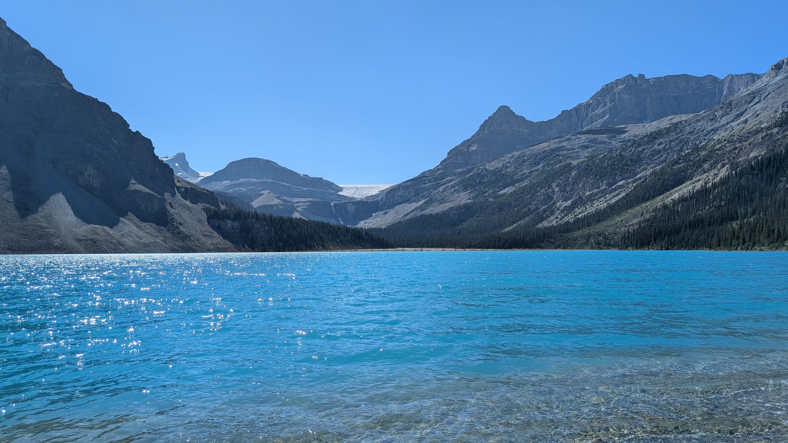

[Statistician & Data Scientist · PhD in Statistics, UBC Okanagan · Kelowna, BC]{.tagline}

I am a statistician who builds models that stay reliable when data are messy, sparse or expensive to collect. I completed my **PhD in Statistics at the University of British Columbia (Okanagan)** in 2026, where my research combined **differential equations with nonparametric regression** to estimate growth and decay curves from limited data, with applications in **fire science, epidemiology and oncology**.

Alongside research, I spent several years as a graduate teaching assistant for mathematics, statistics and data courses, so I am used to explaining technical results to people who aren't statisticians. I also hold an **MA in Statistics from York University**.

I'm looking for roles in **statistics, data science and analytics** where careful modelling makes a real difference to decisions.

## What I work with

::: {.chips}
[Statistical modelling]{} [Nonparametric regression]{} [Differential equations]{} [Simulation studies]{} [Epidemic modelling]{} [Data visualization]{} [Dashboards]{}
:::

::: {.chips}
[R]{} [Python]{} [SAS]{} [SQL]{} [Git]{} [LaTeX]{} [Quarto / R Markdown]{} [Shiny / Flexdashboard]{}
:::

## News

<ul class="news">
<li>Sep 2026Started as a Statistical Consultant at Skytrac, Kelowna, BC.</li>
<li>Sep 2026PhD in Statistics conferred by the University of British Columbia.</li>
<li>Jul 2026Successfully defended my PhD thesis, <em>Differential Equation-Constrained Local Polynomial Regression Models</em>.</li>
<li>June 2026Paper with W. John Braun published in <em>Communications in Statistics: Simulation and Computation</em>.</li>
<li>Oct 2025Reviewed a paper for <em>Communications in Statistics: Simulation and Computation</em>.</li>
<li>Jul 2025Presented at the Maud Menten Institute HQP Summit, University of Alberta, Edmonton.</li>
<li>Jun 2025Presented at the WNAR Annual Meeting, Whistler, BC.</li>
<li>May 2025Presented at the SSC Annual Meeting, University of Saskatchewan, Saskatoon.</li>
<li>Jun 2024Presented at the CSSC, Memorial University, St. John's, NL.</li>
</ul>

## Outside work

I love exploring nature and connecting with plants, and when inspiration strikes I paint watercolours of landscapes and flowers. Feel free to reach out about statistics, data, technology or camping.

{.rounded-img fig-alt="Bow Lake in Banff National Park, with mountains behind turquoise water"}
