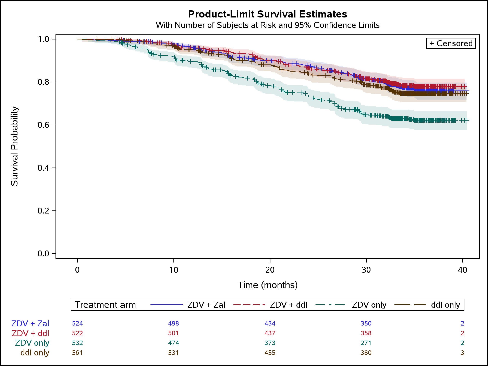
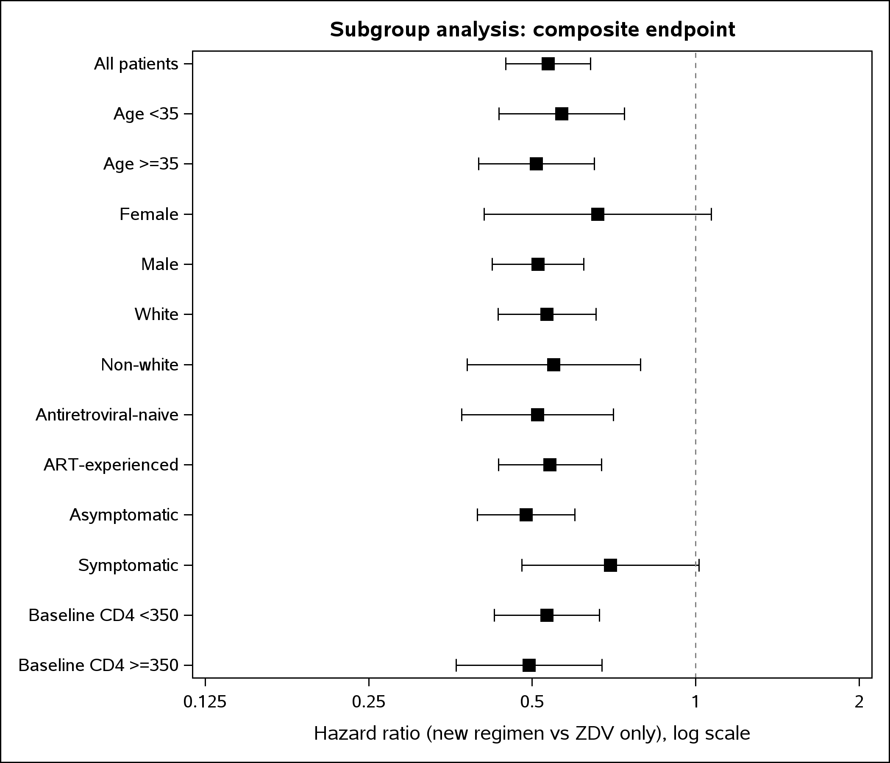
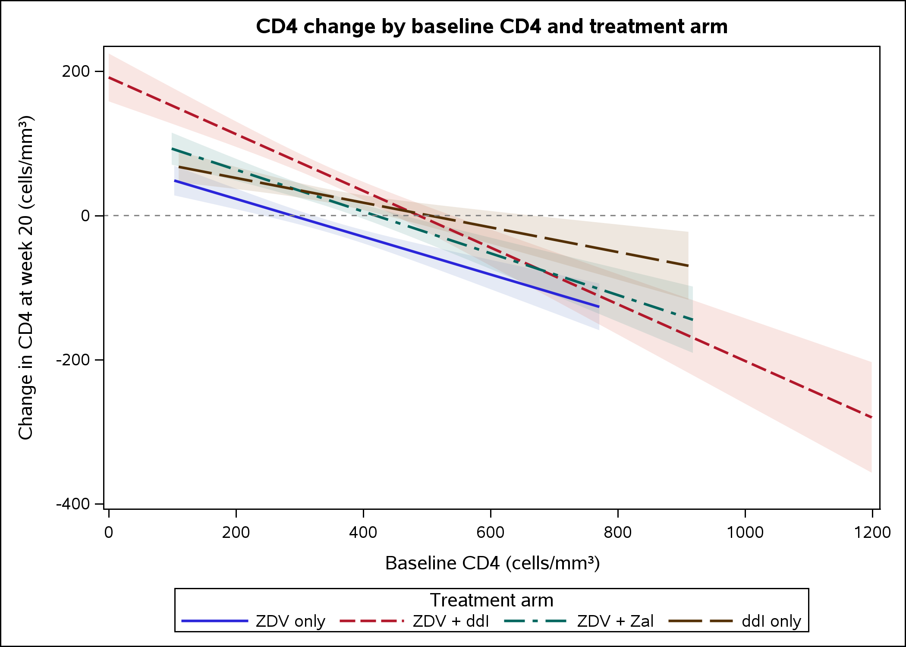

A complete survival analysis of AIDS Clinical Trials Group Study 175, a randomized trial of 2,139 adults with HIV comparing four antiretroviral regimens. The full workflow, from data preparation to Cox models, subgroup analyses and restricted mean survival time, was built in SAS, and the key models were reproduced in R.

[View the code on GitHub ↗](https://github.com/chunleige/actg175-survival-sas)



**Highlights**

- All three newer regimens reduced the hazard of the composite endpoint (CD4 decline ≥50%, AIDS, or death) compared with zidovudine (ZDV) monotherapy, with adjusted hazard ratios of 0.45 to 0.57
- Patients on the newer regimens gained 2.8 to 3.6 additional event-free months within the first three years (RMST, τ = 36 months)
- Treatment effects were consistent across age, sex, race, prior therapy, symptom and baseline CD4 subgroups (all interaction p > 0.10)
- Every key estimate was reproduced in R to at least five decimal places

## Data

ACTG 175 (Hammer et al., *NEJM* 1996), obtained from the UCI Machine Learning Repository. Patients were randomized to ZDV only, ZDV + didanosine (ddI), ZDV + zalcitabine (Zal), or ddI only. The primary endpoint is a composite of a ≥50% decline in CD4 count, progression to AIDS, or death.

## Analysis workflow

| Step | SAS procedures | What it shows |
|---|---|---|
| Data preparation and Table 1 | DATA step, `PROC FORMAT`, `PROC TABULATE`, ODS RTF | Derived variables, labelled baseline table by arm |
| Kaplan–Meier and log-rank | `PROC LIFETEST` | Survival curves, overall and Bonferroni-adjusted pairwise tests |
| Cox models | `PROC PHREG` | Unadjusted and adjusted hazard ratios, Efron vs. Breslow ties |
| Proportional hazards check | `PROC PHREG` (`ASSESS PH`) | Non-proportionality of baseline CD4; stratified sensitivity model |
| Subgroups | SAS macro, `PROC SGPLOT` | Subgroup hazard ratios, interaction tests, forest plot |
| CD4 response | `PROC GLM` | ANCOVA of week-20 CD4 change, Dunnett comparisons |
| RMST | `PROC LIFETEST` | Restricted mean survival time, a summary that does not assume proportional hazards |
| Validation | R `survival`, `survRM2` | Side-by-side SAS vs. R estimates |

## Key results

**Cox proportional hazards models** (reference: ZDV only)

| Regimen | Unadjusted HR (95% CI) | Adjusted HR (95% CI) |
|---|---|---|
| ZDV + ddI | 0.49 (0.39–0.63) | 0.45 (0.36–0.58) |
| ZDV + Zal | 0.52 (0.41–0.67) | 0.51 (0.41–0.65) |
| ddI only | 0.59 (0.47–0.74) | 0.57 (0.45–0.71) |

Adjusted for age, weight, Karnofsky score, baseline CD4 and CD8, sex, race, haemophilia, homosexual activity, injection drug use, symptoms and prior antiretroviral therapy.

**Proportional hazards.** Baseline CD4 clearly violated proportional hazards, so a sensitivity model stratified by baseline CD4 quartile was fitted; treatment effects were essentially unchanged (HRs 0.45, 0.50, 0.56). For treatment, the SAS supremum test supported proportional hazards (p ≥ 0.11), while the Schoenfeld residual test in R suggested mild non-proportionality (p = 0.03). The hazard ratios are therefore read as time-averaged effects, and RMST is reported alongside them.

**Restricted mean survival time** (τ = 36 months)

| Regimen | RMST (months) | Difference vs. ZDV only (95% CI) |
|---|---|---|
| ZDV only | 29.2 | reference |
| ZDV + ddI | 32.7 | +3.6 (2.5–4.6) |
| ZDV + Zal | 32.6 | +3.4 (2.3–4.5) |
| ddI only | 32.0 | +2.8 (1.7–4.0) |



**CD4 response.** In an ANCOVA adjusted for baseline CD4, mean CD4 count fell by 16 cells/mm³ at week 20 on ZDV only and rose on all other regimens. Adjusted differences versus ZDV only were +70 (ZDV + ddI), +36 (ZDV + Zal) and +42 (ddI only) cells/mm³ (Dunnett-adjusted p < 0.0001). The benefit was larger among patients with lower baseline CD4 (arm-by-baseline interaction p = 0.0015). Notably, ZDV + ddI produced the largest CD4 gain even though the three newer regimens did not differ in the clinical endpoint, a reminder that a surrogate marker and a clinical outcome can tell different stories.



## Code examples

A Cox model with explicit Efron ties and reference coding:

```sas
proc phreg data=proj.actg;
  class arms(ref="0") / param=ref;          /* 0 = ZDV only */
  model days*cens(0) = arms age wtkg karnof cd40 cd80
                       gender race hemo homo drugs symptom str2
        / ties=efron risklimits;
run;
```

A macro that fits the same model in each subgroup and collects the hazard ratios for the forest plot:

```sas
%macro sub(var=, val=, label=, order=);
  proc phreg data=work.sg(where=(&var=&val));
    model days*cens(0) = treat / ties=efron risklimits;
    ods output ParameterEstimates=_pe;
  run;
  data _pe;
    length subgroup $40;
    set _pe;
    subgroup = "&label";
    order    = &order;
  run;
  proc append base=work.forest data=_pe force; run;
%mend sub;
```

## Validation in R

Hazard ratios from all Cox models, the log-rank statistic (χ² = 49.19), the ANCOVA estimates and the RMST values matched between SAS and R to at least five decimal places. One detail worth knowing: SAS `PROC PHREG` defaults to Breslow ties while R `coxph()` defaults to Efron, so the two packages disagree slightly unless the method is set explicitly. In this dataset the two methods give nearly identical results because each tied event time involves only one to three events against risk sets of several hundred patients.

## Limitations and next steps

ACTG 175 is a randomized controlled trial, not observational registry data, so the estimated treatment effects are not affected by confounding by indication. Subgroup analyses are exploratory and were not powered for subgroup-specific conclusions. A natural next step is to simulate an observational cohort from these data and apply propensity score methods, the setting typical of HIV registry research.

*Data: Hammer SM et al. (1996). A trial comparing nucleoside monotherapy with combination therapy in HIV-infected adults with CD4 cell counts from 200 to 500 per cubic millimeter. New England Journal of Medicine, 335(15), 1081–1090. Dataset accessed via the UCI Machine Learning Repository (ID 890).*
