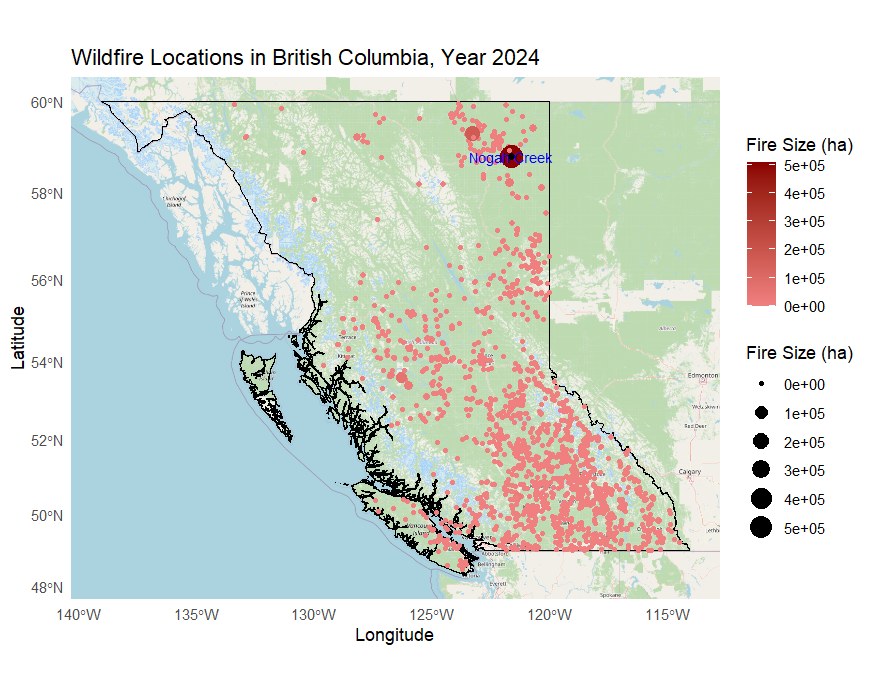

{fig-alt="Map of British Columbia showing 2024 wildfire locations as points, with the largest fires in the northeast, including the Nogah Creek fire, shown as larger, darker points."}

This map shows the location and size of every wildfire recorded in British Columbia in 2024, using data from the BC Wildfire Service.

**What it shows**

- Fires were most numerous in the southern interior, but most of them were small.
- The area burned was dominated by a handful of very large fires in the northeast, including the Nogah Creek fire.

**How it was made**

- Built in R with **sf** for the spatial data, **ggplot2** for the map, and **ggspatial** for the basemap.
- Fire size is mapped to both point size and colour, so the largest fires stand out against the many small ones.
