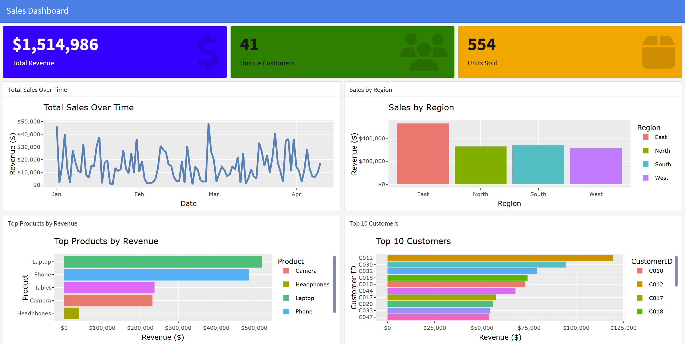

An interactive sales dashboard for an electronics retailer, built on a simulated business dataset and designed to work like a real analytics tool.

[Open the live dashboard ↗](../projects/sales_dashboard.html){.btn .btn-primary}

{.rounded-img fig-alt="Screenshot of the sales dashboard with KPI boxes and charts"}

## Features

- **KPIs** at a glance: total revenue, number of customers, units sold
- **Interactive charts**: revenue over time, sales by region, top products and top customers
- Built with **R, Flexdashboard, Plotly and ggplot2**
